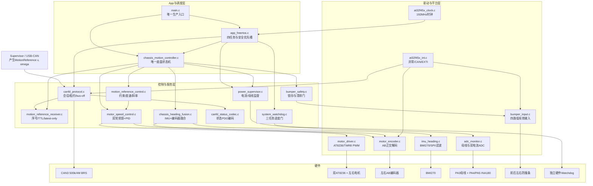
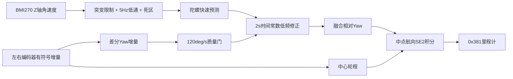
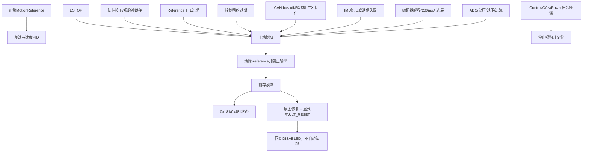

# 电机驱动板当前架构与教学阅读顺序

本文解释当前提交中的真实依赖和已经完成的物理目录分层。课件讲解先沿着
“输入证据 → Reference → 约束与差速 → 速度PID → PWM → 安全反馈”阅读，
再讨论哪些模块可以移动、合并或继续裁剪。

## 1. 当前逻辑分层

源码已经按教学顺序分为`drivers/services/app/config`，运行时职责仍可归纳为三层。

| 逻辑层 | 当前模块 | 主要职责 |
| --- | --- | --- |
| App/调度层 | `src/app` | 启动系统、调度四个任务、维护唯一底盘状态机 |
| 控制/服务层 | `src/services` | 协议、Reference、差速、PID、融合和安全状态 |
| Driver/平台层 | `src/drivers` | MCU外设、传感器、H桥、ISR和WDT |
| 配置 | `src/config` | 电机标定和跨工具链公共常量 |

## 2. 当前模块依赖图



## 3. 正常运动数据流


关键边界：

- 上位机负责路线、RFID、曲线`100 mm/s`策略和任务生命周期；
- 电机板只执行短TTL车体速度参考，不知道道路名称或RFID业务含义；
- 直线`300 mm/s`对应约`67.4 RPM`；
- 原地旋转`1200 mrad/s`对应左右轮约`±67.4 RPM`；
- 单轮超限时左右轮按相同比例缩放，保持原有曲率。

## 4. 航向与里程计数据流



BMI270没有磁力计，因此该Yaw是短时相对航向。编码器约束也可能受打滑影响，
两者都不能替代上位机的绝对定位、磁条或RFID位置基准。

## 5. 安全覆盖关系



安全优先级固定为：

```text
ESTOP / 防撞 / 本地故障 / 通信失效
    > STOP / DISABLE
    > HOLD / BodyVelocity
```

## 6. 四个FreeRTOS任务

| 任务 | 周期 | 优先级 | 读取 | 写入/动作 |
| --- | ---: | ---: | --- | --- |
| `ChassisCtrl` | 10ms | 5 | 安全槽、命令队列、IMU、编码器、Reference | 唯一底盘状态、目标轮速、制动、里程计 |
| `CANFD` | 2ms | 3 | CAN RX、TX状态、总线状态 | 会话、租约、最新Reference、状态发送 |
| `PowerMonitor` | 20ms | 2 | 三通道ADC、编码器静止证据、控制快照 | 电气状态、Power故障命令 |
| `Watchdog` | 20ms | 1 | 三个任务generation | 满足条件才喂硬件WDT |

`safety_epoch`解决的是“STOP之后队列里旧命令重新启动”的问题：安全事件进入
优先槽时推进epoch，普通队列项携带旧epoch就只能被拒绝。

## 7. 建议课堂阅读顺序

1. `drivers/motor_driver.c`：先让学生理解H桥、PWM、方向和制动；
2. `drivers/motor_encoder.c`：学习AB正交编码和输出轴计数；
3. `drivers/adc_monitor.c`、`bumper_input.c`、`imu_heading.c`：读取真实硬件证据；
4. `drivers/system_watchdog.c`与MCU时钟/中断：理解实时底座和失败复位；
5. `services/motor_speed_control.c`：在驱动之上建立前馈+PID速度闭环；
6. `services/motion_reference_control.c`：推导差速、共同限幅和斜率；
7. `services/chassis_heading_fusion.c`：融合IMU和编码器并形成里程计；
8. `services/bumper_safety.c`、`power_supervisor.c`：建立本地保护服务；
9. `services/canfd_protocol.c`与`motion_reference_receiver.c`：加入会话、租约和TTL；
10. `app/chassis_motion_controller.c`：把控制、通信和安全组合为唯一状态机；
11. `app/app_freertos.c`与`main.c`：最后组合四任务并启动完整产品。

## 8. 当前物理分层与后续清洗候选

当前物理目录已经表达逻辑层次，移动文件不改变任何运行行为：

```text
src/
  app/
    main.c
    app_freertos.c
    chassis_motion_controller.c
  services/
    bumper_safety.c
    canfd_protocol.c
    canfd_status_codec.c
    chassis_heading_fusion.c
    motion_reference_control.c
    motion_reference_receiver.c
    motion_command.h
    motor_speed_control.c
    power_supervisor.c
  drivers/
    adc_monitor.c
    bumper_input.c
    imu_heading.c
    motor_driver.c
    motor_encoder.c
    system_watchdog.c
    at32f45x_clock.c
    at32f45x_int.c
  config/
    motor_speed_calibration.h
    math_constants.h
```

目录移动只改善导航，不会自动减少耦合。真正的后续清洗应优先检查：

1. `canfd_protocol.c`是否能进一步压缩硬件、会话和队列的重复样板；
2. `imu_heading.c`的软件SPI探测与BMI270业务是否需要拆成Driver/Service；
3. `chassis_motion_controller.c`是否仍承担过多状态翻译和遥测装配；
4. `power_supervisor_provisional_config()`是否应改成与现状一致的名称；
5. 旧历史文档和未编译`third_party`是否应移出当前教学主线。
